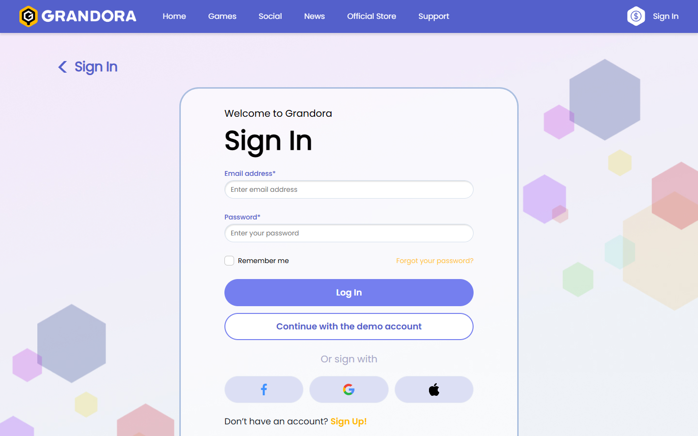
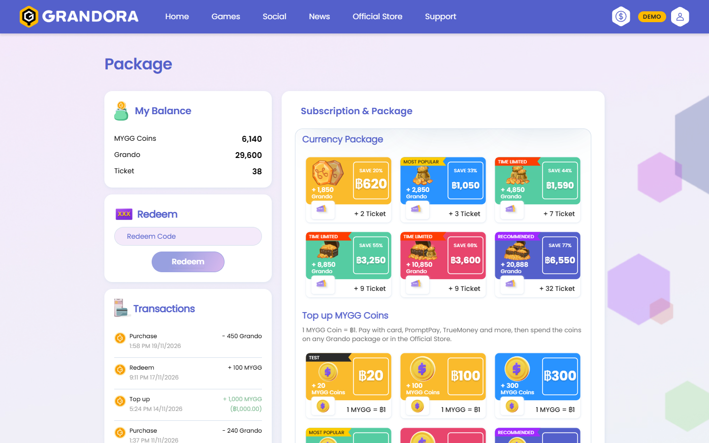
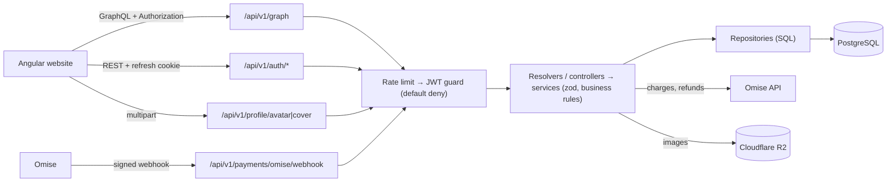
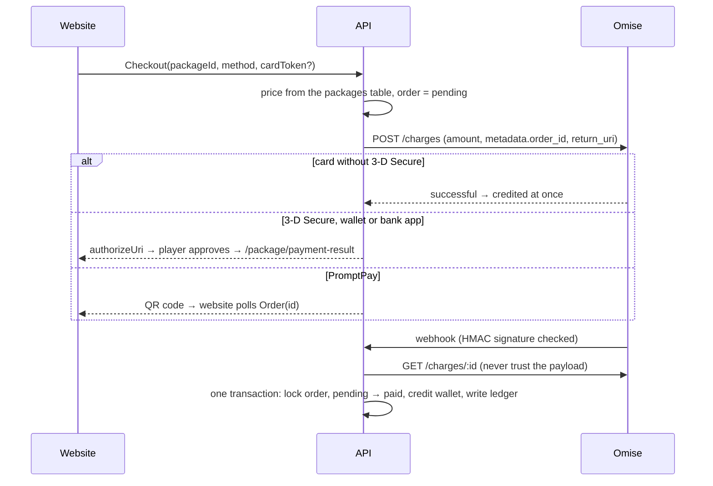
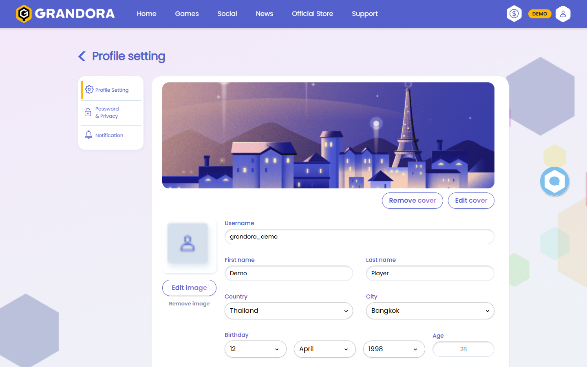
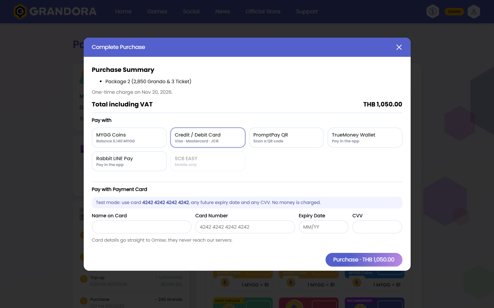
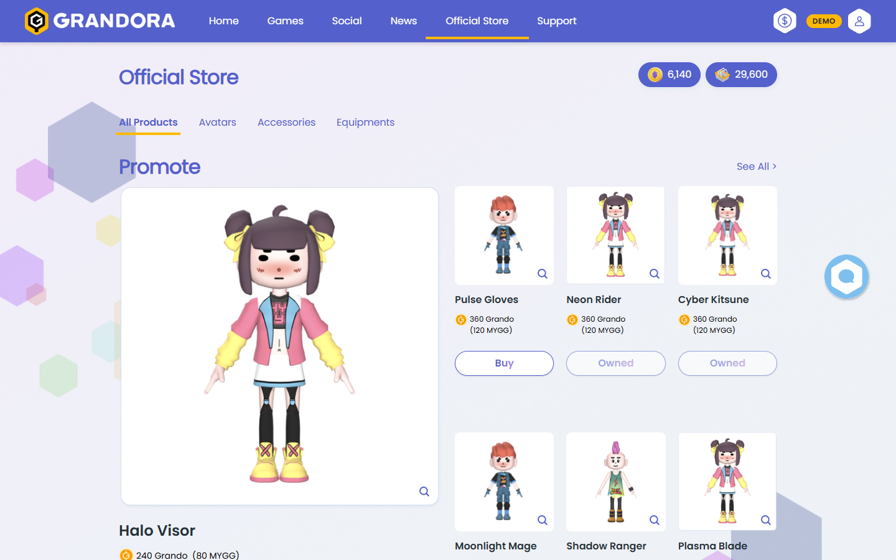

# Grandora

<p align="center">
  
  
</p>

A game platform website: players manage their profile, top up **MYGG Coins** with real money, buy **Grando** packages and shop the official store. Every new browser tab opens straight into a shared **demo account**, so recruiters and visitors can use the real site without signing up.

- **Same API as before.** `LoginEmail`, `RegisterEmail`, `Register`, `items` and `GetSelf` keep their names and fields. The access token still lives in `localStorage.accessToken` and is sent in the `Authorization` header; every data query needs it.
- **Demo entry.** A new tab is signed in to the demo and opens the page a sign-in leads to (`/setting`). Signing out brings back the normal sign-in and sign-up forms for that tab; closing the tab and opening the site again enters the demo again.
- **Real payments with Omise.** Card (3-D Secure), PromptPay QR, TrueMoney, Rabbit LINE Pay, ShopeePay, Alipay, WeChat Pay and mobile banking. A ฿20 package exists to test a real charge.
- **Wallet and ledger.** Integer balances, one atomic `UPDATE` per purchase, an append-only ledger, and refunds or chargebacks taken back automatically.
- **Cloudflare R2** stores every uploaded avatar and cover image.

| Layer | Stack |
| --- | --- |
| Website | Angular 16, Apollo Angular (GraphQL), Omise.js, SweetAlert2 |
| API | Node.js 22+, NestJS 11 on Express, GraphQL (Apollo Server 5, code first), REST for sessions, uploads and webhooks |
| Data | PostgreSQL 17 with raw SQL (`pg`), db-migrate SQL migrations, zod validation |
| Auth | JWT access token (HS256) + rotating HttpOnly refresh cookie, peppered bcrypt |
| Payments / files | Omise REST API with signed webhooks, Cloudflare R2 (S3 API) |

## Backend flow



Every request passes the rate limiter and the JWT guard, which refuses anything not marked public. Services validate input with zod and own the rules; repositories hold the SQL. One exception filter turns every error into `{ status, message, data: null, code }` for REST and `extensions.code` / `extensions.reason` for GraphQL.

**Sign-in and the demo session**

1. `LoginEmail` (or `POST /api/v1/auth/demo`) returns a 15-minute access token and sets a 7-day HttpOnly refresh cookie scoped to `/api/v1/auth`.
2. The website keeps the token in `localStorage.accessToken`. When it expires, an Apollo link calls `POST /api/v1/auth/refresh`, which rotates the cookie (a reused cookie revokes the whole session) and retries the request once.
3. On start-up the website restores a live session; otherwise it enters the demo. A new tab on `/`, `/home`, `/sign-in` or `/sign-up` is sent to `/setting`. After signing out, the tab stays signed out while you move around the site or reload it, so the sign-in and sign-up forms work normally; opening the site in a new tab enters the demo again.

**Paying with Omise**



- The browser only sends a package id and a method; card numbers go to Omise as a one-time token.
- Crediting happens only from a charge fetched from Omise with the secret key: the webhook, the result page's status poll, or a sweeper that re-checks pending charges every 5 minutes (Omise does not promise webhook retries). The `pending → paid` update makes a repeated event a no-op.
- `refund.create` and `dispute.create` take the currency back even if it was spent; a negative balance or any chargeback freezes the account.
- The shared demo account cannot pay real money on live keys.

**Paying with MYGG Coins** needs no gateway. One statement both checks and moves the coins, in the same transaction as the order and ledger rows:

```sql
UPDATE wallets SET mygg_coins = mygg_coins - $2, grando = grando + $3, tickets = tickets + $4
WHERE user_id = $1 AND mygg_coins >= $2;   -- 0 rows updated = not enough coins
```

**Uploads** go to `PUT /api/v1/profile/avatar|cover` as multipart. The API checks the file's real signature (JPEG, PNG, WebP or GIF, 5 MB max), writes it to R2, swaps the reference in one transaction and then deletes the image it replaced. Without R2 keys, development stores files in `backend/uploads`.

## Currency model

| Currency | What it is | How a player gets it |
| --- | --- | --- |
| MYGG Coins | Platform wallet, 1 MYGG = ฿1 | Top-up packages paid through Omise |
| Grando | In-game currency | Grando packages, paid through Omise or with MYGG Coins |
| Ticket | Bonus item | Comes with Grando packages |

Store items are priced in Grando or MYGG Coins. Money is stored in satang and coins as whole numbers; there are no floats anywhere in the money path.

## Run it locally

```bash
# API
cd backend
docker compose up -d            # PostgreSQL 17 on 127.0.0.1:5432 (Adminer on :8080)
cp .env.example .env            # set TOKEN_SECRET and PASSWORD_PEPPER (32+ characters each)
npm install
npm run db:setup                # migrations + mock data
npm run start:dev               # http://localhost:3000, GraphQL and Apollo Sandbox at /api/v1/graph

# Website
cd ../frontend
npm install --legacy-peer-deps
npm start                       # http://localhost:4200
```

Generate each secret with `node -e "console.log(require('crypto').randomBytes(48).toString('base64url'))"`. The database must use UTF-8 (the Docker image does). Production builds of the website read the API address from `frontend/src/app/environments/environment.prod.ts`.

| Backend script | Does |
| --- | --- |
| `npm run seed` | Wipes the data and loads the mock data again |
| `npm run migrate:up` / `migrate:down` | Applies / reverts SQL migrations |
| `npm test` | Unit tests (webhook signature check) |
| `npm run lint` / `typecheck` / `build` | ESLint, TypeScript, compile to `dist` |

**Mock data** (`npm run seed`): the demo account `demo@grandora.games` with 6,140 MYGG Coins, 29,600 Grando, 38 Tickets and four months of orders and ledger history; 6 Grando packages and 6 MYGG top-ups (including the ฿20 test package); 21 store items; closed-beta sign-ups; redeem codes `GRANDORA2026`, `MYGGWELCOME`, `TICKET5` and the expired `EXPIRED2025`.

## Omise payments

1. Put your **test** keys in `OMISE_PUBLIC_KEY` / `OMISE_SECRET_KEY`. Pay with card `4242 4242 4242 4242` (any future expiry, any CVV). PromptPay shows a **Simulate payment** button in test mode; wallets and banks show Omise's test approval page.
2. Omise dashboard → Webhooks → add `https://<your-api>/api/v1/payments/omise/webhook`, then copy its secret into `OMISE_WEBHOOK_SECRET`. Production refuses webhooks without it.
3. Ask Omise to turn on 3-D Secure, and to enable each method you list in `OMISE_PAYMENT_METHODS`.
4. **Real ฿20 test:** switch to live keys, sign up your own account (the demo cannot pay real money), buy *Test Top-up* with your card, then refund it in the Omise dashboard. The refund appears in the transaction history and the 20 MYGG Coins are taken back.

## Cloudflare R2

Create a bucket, allow public access (r2.dev subdomain or a custom domain) and an API token with *Object Read & Write*, then fill in `backend/.env`:

```env
STORAGE_DRIVER=r2
R2_ACCOUNT_ID=
R2_ACCESS_KEY_ID=
R2_SECRET_ACCESS_KEY=
R2_BUCKET=grandora-uploads
R2_PUBLIC_URL=https://pub-xxxxxxxx.r2.dev
```

## API

GraphQL at `POST /api/v1/graph`. All operations need the access token except the three public ones.

| Operation | Purpose |
| --- | --- |
| `LoginEmail(email, password)` · public | `{ token, profile }`, sets the refresh cookie |
| `RegisterEmail(email, password, gender?, dateOfBirth?)` · public | `{ message, success }`, adds a welcome bonus |
| `Register(...)` · public | Closed-beta form |
| `GetSelf` | `inventory { currency { item_id category amount name } }`, balances, profile |
| `items(kind?)` | Packages: `{ ok message data { id name description price image game featured ... } }` |
| `MyProfile`, `UpdateProfile(input)` | Profile settings |
| `Transactions(type, page, pageSize)` | History: `all`, `package`, `redeem`, `store`, `refund`, `bonus` |
| `PaymentConfig`, `Checkout(input)`, `Order(id)`, `MyOrders`, `SimulatePayment(id, result)` | Payments (`SimulatePayment` works with test keys only) |
| `StoreItems(category?)`, `BuyStoreItem(itemId, currency)` | Official store |
| `RedeemCode(code)` | Redeem codes |

REST: `POST /api/v1/auth/demo`, `POST /api/v1/auth/refresh`, `POST /api/v1/auth/logout`, `GET /api/v1/auth/me`, `PUT|DELETE /api/v1/profile/avatar|cover`, `POST /api/v1/payments/omise/webhook`, `GET /healthz`.

## More screens

<p align="center">
  
  
  
</p>

## Project layout

```
backend/
  migrations/              SQL migrations (db-migrate)
  src/
    config/                environment schema (zod); the server refuses to start on a bad value
    database/              pg pool and transactions
    common/                guards, error filter, request helpers
    modules/
      auth/                LoginEmail, RegisterEmail, demo, refresh rotation, JWT, passwords
      users/               profile and image uploads
      wallet/              balances, ledger, GetSelf, transaction history
      packages/            items (packages on sale)
      payments/            orders, Omise client, webhook, checkout
      store/  redeem/  beta/  storage/  health/
    scripts/               seed data
frontend/
  src/app/core/services/   session (token, demo, refresh), auth, payments, shop, profile
  src/app/components/      package card, Add Coin panel, checkout dialog
```

## Before launch

Coins and Grando can never be cashed out or moved between players. Holding a coin balance may raise e-money questions with the Bank of Thailand, and app stores restrict pointing players to an outside top-up site, so check both with a Thai lawyer before going live.
